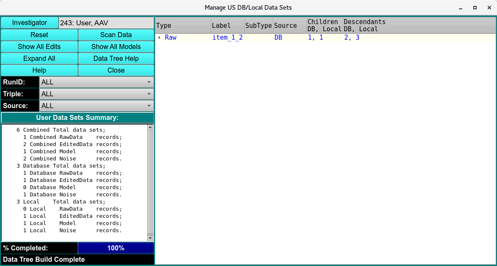
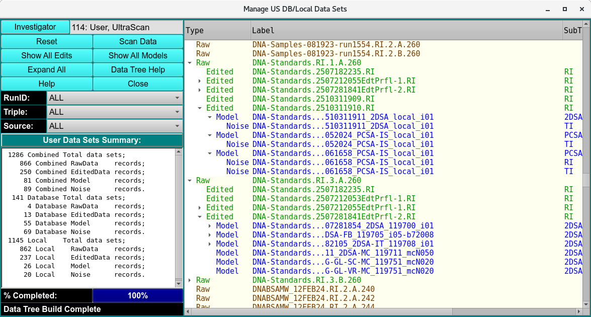
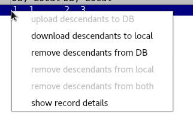

==========================================
Manage Data in Database and on Local Disk
==========================================

.. toctree:: 
  :maxdepth: 3

.. contents:: Index
  :local: 

This module is used to display the four main types of data that may exist for the user in the database and/or on local disk. They are: (1) Raw experiment data; (2) Edited experiment data; (3) Model; and (4) Noise. Each of those hangs off an experiment, which is the top level of the tree. Besides presenting a tree view of the user's data and their relationships, this module provides a simple means of performing processing on data: (1) upload to DB; (2) download to local disk; (3) remove from DB or local. 

.. note::

   A row that both the database and local disk hold reads **Unverified**
   (teal) until the two copies have actually been compared; it then turns
   **In Sync** (green) or **Conflict** (red). A copy that could not be read
   for the comparison counts as a conflict, not as in sync. Comparing means
   hashing the record contents on both sides, which for a multi-wavelength
   run is the slowest part of a scan by a wide margin, so it is done after
   the tree is complete and only for the experiments that exist in both
   places -- a record that is in one place only has nothing to be compared
   against. Opening an experiment moves it to the front of the comparison
   queue -- also while the scan is still reading the records, in which case
   it is compared first when the comparisons start; outside a scan the
   comparison runs in the background, one experiment at a time between other
   events, so opening rows does not wait for it. An experiment row reads
   what its records read, as the tree shows them: **Conflict** when any
   record under it does, **Unverified** while any of them has not been
   compared, and **In Sync** otherwise. A record you upload or download is
   compared again, on its own, straight afterwards; until then it and its
   experiment read **Unverified**.

The primary end of any processing of the data is to achieve a synchronizing of data in the database and on local disk. Particularly when preparing for off-network work or when returning to the network after such work, it is desirable to insure that any new data produced has a presence on local disk for off-network work and in the database for normal day-to-day processing. Instances of any data need to be in sync on the two media. This module provides a means to accomplish that.   

Data Management Process:
==========================

    * **Database Password:** Upon opening, US_ManageData requires you to sign on to the database with your DB password. 
    * **Investigator:** For database work, you must specify your investigator name so you are limited to data that you have permission to access and modify. 
    * **Scan Data:** Initiate a scan of all your data on the database and local disk. The scan runs in three phases: the experiments appear first, each with a count of the records under it; the records below them are then read -- from the database in a handful of queries for the whole store, and from disk in a single pass -- and filled into the tree as they arrive; finally the experiments that exist in *both* the database and on local disk are compared record by record, which is what turns a row red when the two copies have drifted apart. With a run selected in **RunID**, only that run is read, one query per kind of record, instead of the whole store. The local disk is read on a thread of its own, so that walking thousands of files happens at the same time as the database queries rather than after them. The window takes input between experiments: while a database query runs it does not respond, and while the local files are being read it is redrawn but ignores the mouse and keyboard. Between experiments you can open experiments in the tree while the rest of it is still being read; the buttons, the filters, **Close** and the row context menus are disabled until the scan is done, and closing the window from its title bar stops the scan and closes it without the reports below. Two progress bars say where a scan is: the upper one (**Overall**) counts the steps of the phase that is running -- listing, reading, comparing -- and the lower one (**This experiment**) the work inside the experiment being read or compared. When the scan is done, any error it ran into is reported -- in particular, if the database could not be listed, every record would otherwise appear to be on local disk only -- and records that share a GUID with another record, in any experiment, are reported once. A record held once in the database and once on local disk is two copies of one record, not a duplicate; a duplicate is a GUID that the database, or the local disk, holds more than once. A local results directory that does not exist yet is an empty store, not an error.
    * **Navigate and Process:** Once you have a tree view of your data, you may navigate it using expand/collapse buttons or the normal **+** and **-** mechanism for specific branch expand and collapse. Opening an experiment the scan has not reached yet moves it to the front of the queue -- both for reading it and for comparing it -- so what you are looking at is dealt with first. Context menus at each row allow upload/download/remove/details, and acting on an experiment acts on everything under it, and only on that. When nothing selected can take an action (removing from the database records that are only on local disk, say) you are told so rather than shown a success. The sample tree shown before the first scan is not your data, and no action can be taken on it.
    * **Upload and download:** A record is uploaded only when its parent is in the database, and downloaded only when its parent is on local disk; acting on the parent takes its descendants along, top down, so selecting the edit downloads the edit and then its models. Uploading a record the database already holds (a **DB replace**) first compares the two copies: when they hold the same thing, nothing is written and you are told the record is already in sync -- whatever the dates say, since the database copy may well have come from that very file. Only when the copies differ is a local copy that is older than the database copy refused; both dates are read as UTC.
    * **Experiments:** The top level of the tree is one row per experiment, labelled with its run ID. Before an experiment has been read, its *Descendants* column shows how many records the listing says are under it ("?" when the source cannot say without reading them); once read, it shows what is actually in the tree. The summary on the left counts experiments without the stand-in rows described below.
    * **Orphans:** A record whose parent is missing (a model whose edit was removed, or an edit whose raw data is gone) is shown at the end of the tree under a stand-in experiment, **(records of no experiment)**, below gray **dummy** filler rows that stand in for its missing parents, so that it can still be seen and removed. Global models, which have no edit by design, are under a stand-in of their own, **(global models)**. A stand-in row is no record itself: its *Source* reads **--**, and the records under it that are in both places are compared like any others. Removing from a stand-in row removes everything under it, so you are asked again, with the number of records that would go. A record whose parent is in the other place only -- a model on local disk whose edit is only in the database, say -- is not an orphan: it is shown under that parent, paired with its other copy. Only a scan of the whole store can tell a missing parent from one that was not read, so orphans are not shown when the tree is narrowed to one run or one triple.
    * **Runs with problems:** A run that should not be acted on as it stands is marked **(!)** after its run ID; holding the mouse over it says why, and the problems are listed when the scan is done. A run ID with dots in it is from an older version of UltraScan (new run IDs may use only letters, digits, ``_`` and ``-``); such runs are still shown and can be acted on. Other problems are a run directory not named after the run its data files name, data files of more than one run in one directory, and two directories holding the same run. Nothing is uploaded or downloaded for a run whose directory is not named after it or is not the only one holding it -- what would be written would not go where the run is -- until its directory is put right; its records can still be removed.

Initially you are presented with a small window to enter your database password. Then you will see the main window with a sample data tree that shows the kinds of states that data may be in (see tree help below).

.. rst-class:: 
    :align: center

    **Data Main Window**

 After clicking on the **Scan Data** button, the tree will be populated with your actual data. 

.. rst-class:: 
    :align: center

    **Populated Data Manager**

.. _manage-data-thelp:

The tree menu will expand and collapse with buttons like these.

.. grid:: 2
  :gutter: 2 

  .. grid-item:: 

    .. image:: _static/images/manage_data_bshow.png
      :align: left
      :width: 100%  
  
  .. grid-item:: 

    .. image:: _static/images/manage_data_bhide.png
      :width: 100%
      :align: right

.. rst-class:: center

    **Tree Menu Buttons**

.. _manage-data-cmenu:

Data Management Functions:
============================

.. list-table::
  :widths: 20 50
  :header-rows: 0

  * - **Investigator:**
    - Often the investigator text field will already be correctly filled out if your home directory name is the same as the first or last of your investigator name. If not, you may enter all or a portion of the first or last name and hit the **Enter** key to have the investigator found. If that, too, fails, you may click the button to enter a full :doc:`Investigator dialog <us_investigator>`. Choosing another investigator resets the window, as **Reset** does: what was shown was the previous person's, so scan again.
  * - **Reset**
    - Reset the tree to the default sample data.
  * - **Scan Data**
    - Click this button to initiate a full scan of all your data in the database and on local disk. The list of experiments appears straight away; the records under each experiment are read afterwards and appear as they are read; and the experiments held in both places are then compared. Records you upload or download are compared again by themselves; re-initiate a scan to see changes made outside this window.
  * - **Show All Edits**
    - Expand the tree view to insure all rows at the level of Edited data are revealed. The button will then be relabelled **Collapse All** so you can hide edits and their descendants.
  * - **Show All Models**
    - Expand the tree view to insure all rows at the level of Model data are revealed. The button will then be relabelled **Hide All Models** so you can hide models and their descendants.
  * - **Expand All**  
    - Expand the tree view to insure all rows at the level of Noise data and their ancestors are revealed. The button will then be relabelled **Hide All Noises** so you can hide noise record rows.
  * - **Data Tree Help**
    - This button lets you pop up a :ref:`Tree Help Text <manage-data-thelp>` Window with some helpful notes on use of the tree view and on the color legend for its rows.
  * - **Tree Navigation and Context Menus**
    - Individual rows in the tree view may be expanded ("+") to show children and other descendants or may be collapsed ("-"). A right-mouse-button click on any row brings up a :ref:`Manage Data Context Menu <manage-data-cmenu>` that allows you to perform processes on the data record or show details about it.
  * - **Help**
    - Display this and other documentation.
  * - **Close**
    - Close all windows and exit. Disabled while a scan runs; closing the window from its title bar stops the scan first.

