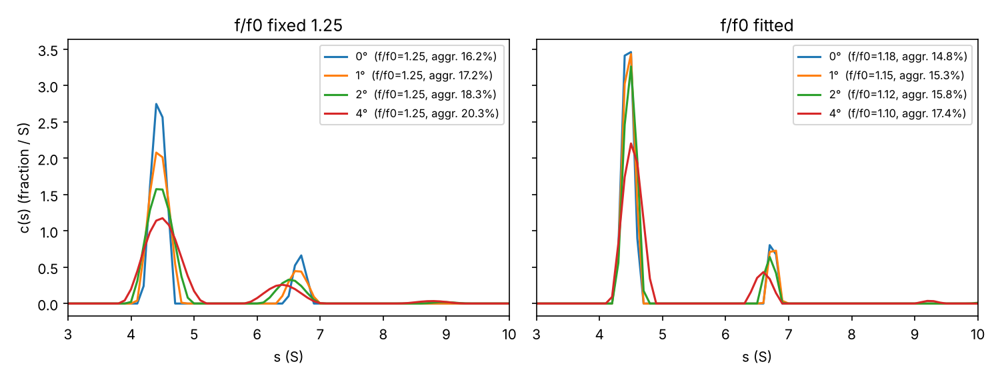

# Rotational cell misalignment: model and prototype

A misaligned cell is turned in the rotor hole by an angle δ about its own
axis, so its sector walls are no longer radial. This directory has the
reference implementation of the model, in Python, and the parameter study.
The model also runs in the ASTFVM solver (`US_LammAstfvm`) through
`US_CellMisalignment` (`utils/us_cell_misalign.{h,cpp}`).

## 1. Literature (summary)

| Source | Finding |
|---|---|
| Arthur et al. 2009, *J Pharm Sci* 98:3522 (PMID 19130472) | Cell alignment is the largest source of variability in aggregate quantitation by SV-AUC. |
| Gabrielson et al. 2009, *Anal Biochem* 396:231 (PMID 19782040) | Multi-lab precision study; lists alignment as a precision factor. |
| Doyle et al. 2017, *Anal Biochem* 531:16 (PMID 28529050) | An optical alignment system improves the precision of aggregate quantitation. |
| Channell et al. 2018, *Eur Biophys J* 47:809 (PMID 30159596) | BSA misaligned by ±1°, ±2°, ±4°. Monomer and dimer peaks in c(s) broaden. The dimer s falls; the monomer s does not change. |
| Khasa et al. 2021, *Mol Ther Methods Clin Dev* 21:585 (PMID 34095342) | A 4° misalignment raises the BSA aggregate fraction from 16 % to 20 % in SV. Band-forming centrifugation is insensitive to ±5°. |
| LeBrun et al. 2018, *PLoS One* 13:e0201529 (PMID 30059530) | Scribe-line alignment is typically within 0.5°. Gives the optical registration error of a rotated pattern. |
| Vezočnik et al. 2025, *J Pharm Sci* 114:103977 (PMID 40882870) | Checks alignment inline from the instrument's own scans. |
| Luo et al. 2026, *Eur Biophys J* 55:639 (PMID 41830968) | Alignment effects in AAV SV-AUC. Content not verified. |
| Schachman 1959; To et al. 2019, *Anal Chem* 91:5866 | Qualitative: non-radial walls produce lateral density gradients and convection. |

No quantitative or mechanistic model of sedimentation in a misaligned cell was
found: no Lamm-equation extension and no CFD. All evidence is empirical
(c(s) output).

## 2. Model

### 2.1 Geometry (exact)

Take a sector of half-angle α whose channel centre line is at polar angle β,
and rotate it by δ about a pivot at radius r_p, the cell centre (6.5 cm in
An-50/An-60 rotors).

- **Wall line.** The wall that was at polar angle φ₀ = β ± α now runs at
  angle φ₀ + δ and lies at distance
  `p = r_p [sin(φ₀+δ) − sin φ₀] ≈ r_p δ` from the rotor axis.
- **Wall tilt.** At radius r the wall makes an angle ψ with the radial
  direction, with `sin ψ(r) = p / r`. For δ = 1° at r = 6.5 cm, ψ ≈ 1.00°.
- **Channel width.** The angular width changes only at O(αδ²), so the radial
  cross-section A(r) and the radial dilution are those of the aligned cell.
  The meniscus stays at r = const because it is an iso-potential surface.
- **Off-centre channels** (β ≠ 0) shift radially by `−δ r_p sin β`. That is
  −30 µm for δ = 1° and β = 1.5°.
- **Flat bottom.** The tilted bottom face spans `2α r_b sin δ` radially:
  55 µm per degree.
- **Optics.** The beam at the nominal centre line stays more than 1.2 mm from
  the walls for δ = 1°, so there is no clipping. Absorbance optics see c(r)
  only, so misalignment adds no optical smearing in the ideal case.

### 2.2 Transport closure

- **Wall layers.** At a tilted wall the wall-normal sedimentation flux
  c v sin ψ has to be balanced by diffusion. This leaves a depleted layer on
  the "upstream" wall and an enriched layer on the other wall.
- **Why they move.** A lateral density anomaly in a centrifugal field has no
  hydrostatic equilibrium. The depleted layer rises to its neutral level,
  which is inside the boundary. The enriched layer slides to the bottom.
- **Analogy.** This is the Boycott effect, described kinematically by
  Ponder (1925), Nakamura & Kuroda (1937), and Acrivos & Herbolzheimer (1979)
  (PNK theory).
- **Coriolis.** The flow is planar and perpendicular to Ω, so the Coriolis
  force is a pure gradient and does not suppress it.

Averaged over the cross-section, this gives a 1D equation:

```
∂c/∂t = −(1/r) ∂/∂r [ r ( s ω² r c − D ∂c/∂r ) ] − u(r) ∂c/∂r
u(r)  = κ s ω² p (b − r) / (Φ r)          (Φ = angular width, b = bottom)
```

The solute removed by the last term is deposited at the bottom. Solvers use
the equivalent conservative form:

```
v_eff = s ω² r (1 + ε(r)),   ε(r) = κ p (b − r) / (Φ r²)
sink  = −k(r) c,             k(r) = κ s ω² p / (Φ r)
```

- **Sharp-boundary limit.** For a sharp boundary the PNK law follows:
  `dr_b/dt = s ω² r_b [1 + κ p (b − r_b)/(Φ r_b²)]`.
- **Plateau.** The plateau dilutes radially exactly as in the aligned cell.
- **κ ∈ [0, 1]** is the transport efficiency of the wall layers. κ = 1 is the
  convection-dominated limit; κ = 0 is the ideal aligned cell.
- **Time scales.** The 2D probe (`misalign2d.py`) shows buoyancy-driven
  velocities of about 0.1 cm/s, roughly 10³ times the sedimentation velocity.
  This time-scale separation is what justifies the quasi-static closure.

## 3. Prototype

| File | Content |
|---|---|
| `misalign1d.py` | Geometry; a 1D sector Lamm solver (Scharfetter–Gummel finite volume) with the closure; least-squares fitting with the ideal model. |
| `study.py` | Fits misaligned-cell data with the aligned model to get apparent s, D and dimer fraction versus δ and κ. Writes `results.json`, `fig_bias.png` and `fig_profiles.png`. |
| `misalign2d.py` | Exploratory 2D Stokes–Boussinesq–Lamm model in a tilted channel. It is stiff (see its header) and is kept only to document the time scales. |
| `misalign2d_implicit.py` | Implicit 2D Stokes–transport solver (section 5). |
| `analysis2d.py`, `plot2d.py`, `plot2d_summary.py` | Fits of the 2D runs with the 1D model; figures. `results2d.json` holds the fit results. |
| `utils/us_cell_misalign.*` | C++ geometry and the dispersive closure (section 8). |
| `utils/us_lamm_astfvm.*` | s(1+ε_s) and D(1+ε_D) applied in `AdjustSD` (all non-ideal cases). |
| `utils/us_simparms.*` | Fields `misalign_angle` (deg, default 0), `misalign_pivot` (cm, 6.5), `misalign_gamma_D` (0.033), `misalign_gamma_s` (0.033/13.5) and `misalign_conc` (total loading concentration, mg/mL, 1.0). Written to and read from simparams XML only when the angle ≠ 0; part of the `US_SimCache` key. |
| `test/utils/test_us_cell_misalign.cpp` | Unit tests: geometry against the Python reference, closure calibration, XML round trip, γ = 0 identical to the aligned cell, ASTFVM run equivalent to an aligned run with scaled s and D. |

How to use it: set `simparams.misalign_angle` (and optionally the pivot, the
γ coefficients and the loading concentration) and select the ASTFVM mesh
type. ASTFEM ignores the misalignment and prints a warning.

### Verification (PNK closure, superseded — see section 8)
- **Python solver.** Mass is conserved to 1e-15. The boundary midpoint
  matches the analytic PNK trajectory to within one grid cell (3 µm).
- **C++ against Python.** The C++ ASTFVM and the Python solver agree on the
  boundary midpoint within 0.3–3 µm (δ = 1°, κ = 1, 50 krpm, BSA).
- **C++ against PNK.** The excess shift in C++ matches the PNK prediction to
  within 1 %.

## 4. Results of the PNK closure (superseded; BSA, 50 krpm, r_m = 6.0, b = 7.2 cm, 2.5° sector, 3 h)

See `results.json`, `fig_bias.png` and `fig_profiles.png`.

Preliminary (κ = 1; true values s = 4.4 S, D = 6.0e-7 cm²/s, dimer fraction 15 %):

| δ (°) | s_app (S) | D_app (1e-7) | rmsd | 2-species fit: s₁ / s₂ / f₂ |
|---|---|---|---|---|
| 0    | 4.400 | 5.98 | 6e-5   | 4.401 / 6.802 / 0.150 |
| 0.25 | 4.464 | 5.92 | 1.7e-3 | 4.470 / 6.903 / 0.146 |
| 0.5  | 4.528 | 5.85 | 3.4e-3 | 4.536 / 6.999 / 0.143 |

The full table for δ up to 4° and κ ∈ {1, 0.1} is produced by `study.py`.

## 5. Implicit 2D Stokes–transport solver

The 2D model is planar, with a curl-free tilted field (equations in
`misalign2d.py`). It omits sector divergence, which is identical for the
aligned and the misaligned cell to O(α). There are two implementations:

- **`misalign2d_bdf2.py` (production).**
  - Time stepping: BDF2, started with one backward-Euler step.
  - Unknowns: c (cell centres), Ψ and ω (nodes), solved in one coupled sparse
    system per iteration with PARDISO. The no-slip wall vorticity uses Woods'
    condition.
  - Lateral grid: tanh-stretched, clustered at the walls (`--ybeta`).
  - Iteration: Newton–Picard on the bilinear flux c·u(Ψ) and on the minmod
    second-order correction, 3–7 iterations per step to a residual below 1e-7.
  - Mass is conserved to 1e-10.
- **`misalign2d_implicit.py` (superseded).** First-order backward Euler on a
  uniform grid.

**Analysis (`analysis2d.py`).**
- Profiles are averaged along lines of constant radius, weighted by cell
  width. With `--center`, the channel centre line (the absorbance beam) is
  used instead.
- Profiles are fitted with the ideal planar 1D model (s, D free), and
  alternatively with the closure (s, D, κ_a, κ_d free).
- Effects are quoted relative to the aligned run on the same x-grid. This
  removes the solver's numerical diffusion. The aligned run has no lateral
  structure, so it does not depend on the y-grid.

Setup: BSA (4.4 S, 6.0e-7 cm²/s), 50 krpm, r_m = 6.2 cm, L = 0.9 cm,
W = 2.8 mm, t = 4000 s. Unless stated otherwise: grid 120×40, β = 3,
dt = 5 s.

**Convergence (BDF2, ψ = 1°, c0 = 0.01 mg/mL)**

| run | Δs/s | ΔD/D |
|---|---|---|
| uniform y, dt = 10 / 5 / 2.5 s | +0.50 / +0.50 / +0.50 % | +6.32 / +6.34 / +6.34 % |
| β = 2 | +0.58 % | +7.35 % |
| β = 3 | +0.58 % | +7.33 % |
| β = 3, Ny = 60 | +0.58 % | +7.37 % |
| β = 3, Nx = 180 (aligned reference on 180) | +0.60 % | +7.21 % |

- **Time step.** The error is negligible (< 0.02 % in s and D for
  dt = 2.5–10 s). The strong dt dependence of the old solver (ΔD/D = 8.1 /
  5.7 / 4.5 % at dt = 10 / 5 / 2.5 s) came from first-order splitting of the
  flow–transport coupling. Its Richardson estimate (≈ 3.3 %) was wrong.
- **Lateral grid.** A uniform 40-cell grid under-resolves the wall layers and
  underestimates ΔD/D by about 15 %. The clustered grid converges to 1 %.
- **Radial grid.** Nx = 120 versus 180 agree to 2 %.
- **Estimated accuracy:** about 3 % of the effect.
- **High c0.** For c0 ≥ 0.3 mg/mL, the coupling iteration diverges at
  dt = 5 s. Converged runs use dt = 2 s (0.3 mg/mL) and dt = 1 s (1 mg/mL).

**Results (BDF2, clustered grid)**

| ψ | c0 (mg/mL) | Δs/s | ΔD/D | ΔD/D ÷ Δs/s | rmsd (aligned 1.4e-3) | max\|u\| (cm/s) | lateral rms |
|---|---|---|---|---|---|---|---|
| 1° | 0.01 | +0.58 % | +7.3 % | 12.6 | 6.7e-3 | 2.7e-3 | 4.9e-3 |
| 1° | 0.1 | +0.45 % | +5.5 % | 12.3 | 5.6e-3 | 5.4e-3 | 2.5e-3 |
| 1° | 0.3 | +0.39 % | +4.8 % | 12.3 | 5.1e-3 | 7.7e-3 | 1.8e-3 |
| 1° | 1.0 | +0.33 % | +4.3 % | 12.9 | 4.6e-3 | 1.1e-2 | 1.3e-3 |
| 2° | 0.1 | +0.97 % | +11.5 % | 11.8 | 9.8e-3 | 7.0e-3 | 4.3e-3 |

max|u| and the lateral rms are taken at t = 4000 s. The table excludes two
runs: without flow, ψ = 1° gives +0.02 % / +0.4 %. With the old solver,
c0 = 0.001 mg/mL gives ΔD/D = 9.2 %.

Figures:
- `fig2d_field.png`: field and profiles at 0.01 mg/mL (old solver).
- `fig2d_summary.png`: effect versus c0, comparing the BDF2 and old series.

**Findings**

1. **The flow causes the artifact.** Sedimentation–diffusion alone in a
   tilted channel produces wall layers but no measurable bias. The artifact
   comes from the buoyancy-driven flow these layers set up, which reaches
   10–100× the sedimentation velocity even at 0.001 mg/mL.
2. **The signature is broadening, not an s shift.** ΔD/D ≈ 12.5 × Δs/s,
   independent of c0 (0.01–1 mg/mL) and of ψ. The effect is linear in ψ:
   ψ = 2° gives 2.1× the value at 1°. Misfit with a single ideal species is
   3–7× the aligned baseline. Qualitatively this matches the experiments:
   broadened c(s) peaks and an essentially unchanged monomer s (Channell 2018).
   Spurious species and aggregate bias in c(s) are a plausible consequence,
   but were not computed here.
3. **The effect decreases only weakly with concentration.** Both ΔD/D and
   Δs/s scale as c0^-0.12 over 0.01–1 mg/mL. That is half the exponent
   estimated with the old solver (−0.24), so its extrapolation (≈ 1.8 % at
   1 mg/mL) underestimated the effect by a factor of 2.4. Stronger convection
   homogenizes the cross-section (lateral rms 4.9e-3 → 1.3e-3), but the flow
   speed grows (2.7e-3 → 1.1e-2 cm/s) and keeps dispersing the boundary.
   **Quantitative rule at 50 krpm and 0.01–1 mg/mL:**
   ```
   ΔD/D ≈ 4.3 % · (ψ/1°) · (c0 / 1 mg/mL)^-0.12
   Δs/s ≈ ΔD/D / 12.5
   ```
   ψ ≈ δ for the pivot at the cell centre. A 1° misalignment is therefore
   relevant for D and for the MW from s/D (about −4 %) at any practical
   concentration. For s it is marginal (0.3–0.6 %).
4. **The PNK closure is rejected.** The plateau is depleted by about 1 %:
   solute goes to the bottom in the enriched layer, while the depleted layer
   mixes laterally instead of rising to the boundary. The advective closure
   (κ_a, κ_d) barely reduces the misfit (by about 6 %), and its parameters are
   not identifiable: κ_a varies from 0.3 to 1.6 across grids of equal
   accuracy and trades off against s. The 1D closure in
   `US_CellMisalignment`/`US_LammAstfvm` (PNK, κ) is therefore not supported
   as a description of the hydrodynamics. A dispersive closure fits the data
   better, e.g. D_eff = D (1 + γ ψ c0^-0.12), with a weak velocity term
   Δs/s ≈ γ/12.5 · ψ c0^-0.12. Its speed dependence is still open.

## 6. Open points

1. **Speed, geometry and size dependence.** Run the 2D model at other rotor
   speeds and solution column lengths to obtain γ(ω, L). The present
   calibration holds only at 50 krpm, L = 0.9 cm and 4000 s.
2. **Sector geometry** — done (section 9).  Still open: salt stratification (which stabilizes the wall layers and may reduce the
   effect), temperature and multiple species. Then reconstruct c(s) to compare
   with the published aggregate bias.
3. ~~**Replace the C++ closure.**~~ Done (section 8).
4. **Out of scope:** tilt of the cell axis, band-forming cells, ASTFEM, GUI
   controls (us_astfem_sim), and us_mpi_analysis.

## 7. Comparison with published c(s) data

Conditions of Channell et al. 2018 (doi:10.1007/s00249-018-1328-9): BSA
0.7 mg/mL, monomer/dimer 82/18 % (4.4 S / 6.6 S), 45 krpm, 12 mm column
(r_m = 6.0, L = 1.2 cm), 4 h, 48 scans.  2D runs `misalign2d_multi.py`
(two species, common v̄, BDF2 with adaptive step), iso-radius mean,
noise 0.3 %, c(s) by `cs_analysis.py` (NNLS + Tikhonov, P = 0.68).
The 0° run carries the bias of the 2D grid (f/f0 1.18 instead of 1.35);
all statements are relative to it.

f/f0 fixed at 1.25 (as in Channell):

| ψ  | s mono | σ mono | h mono | s dimer | σ dimer | dimer + >8.8 S |
|----|--------|--------|--------|---------|---------|----------------|
| 0° | 4.425  | 0.187  | 2.74   | 6.675   | 0.085   | 16.2 %         |
| 1° | 4.425  | 0.248  | 2.07   | 6.647   | 0.129   | 17.2 %         |
| 2° | 4.433  | 0.304  | 1.57   | 6.538   | 0.222   | 18.3 %         |
| 4° | 4.457  | 0.373  | 1.17   | 6.511   | 0.522   | 20.4 %         |

f/f0 fitted: 1.18 / 1.15 / 1.12 / 1.10; dimer s 6.746 → 6.597 S, aggregate
14.8 → 17.4 % (0 → 4°).  Time-step check at 4° (dt ≤ 1 s vs adaptive ≤ 2 s):
dimer s 6.506 vs 6.511, all fractions identical to 0.1 %.



Agreement with the literature:

* monomer s practically unchanged (+0.7 % at 4°), dimer s decreases
  (−2.5 %), both peaks broaden, peak heights fall — as reported by
  Arthur et al. 2009 (doi:10.1002/jps.21654) and Channell et al. 2018;
* apparent aggregate 16 → 20 % at 4°, matching the BSA value quoted by
  Khasa et al. 2021 (doi:10.1016/j.omtm.2021.04.008); part of it is a
  spurious >8.8 S peak;
* with f/f0 floated, the convective broadening is absorbed as an apparent
  lower f/f0 (higher D) — the fixed-f/f0 analysis is what makes the
  misalignment visible.

Not reproduced: the model is symmetric in ±ψ, so the off-centre minimum
of aggregate content (Doyle et al. 2017, doi:10.1016/j.ab.2017.05.018;
Channell 2018) needs an additional cause, e.g. an offset of the
angular reference.

## 8. Dispersive closure (C++)

**Flux decomposition.** `flux_decomposition.py` recomputes the flow from the
saved 2D fields and splits the lateral-mean convective flux of each species,
F_k = ⟨U c_k⟩, into a drift and a dispersion,
F_k = v_k c̄_k − K_k ∂c̄_k/∂x, by least squares over the column (bottom
region excluded).  Two-species runs of section 7 (45 krpm, 0.7 mg/mL):

| ψ | monomer v/v_sed | monomer K/D | dimer v/v_sed (t = 1.2 → 12 ks) | dimer K/D |
|---|---|---|---|---|
| 1° | +0.7 % | 0.08–0.13 | +0.9 → −7 % | 0.06–1.1 |
| 2° | +1.5 % | 0.15–0.27 | +1.8 → −19 % | 0.18–0.6 |
| 4° | +3.0–3.7 % | 0.28–0.47 | +3.7 → −19 % | 0.4–1.1 |

The monomer (the species carrying most of the density gradient) follows a
drift–dispersion law (R² = 0.86–0.96) with both coefficients
proportional to ψ.  Fitting each species of these runs separately with the
ideal model gives the same picture (monomer Δs/s = +0.6 / +1.4 / +3.1 %,
ΔD/D = +7.5 / +13 / +21 %; dimer Δs/s = −0.9 / −1.8 / −3.1 %,
ΔD/D = +18 / +50 / +81 %).  The minor, faster species is carried backward
by the overturning flow that the main boundary drives: the species are
coupled through the common flow.

**Closure.** `US_CellMisalignment` now implements, per species,
```
s_eff = s (1 + ε_s),  D_eff = D (1 + ε_D)
ε_D = γ_D · ψ/1° · (c/1 mg/mL)^-0.12,  ε_s = γ_s · ψ/1° · (c/1 mg/mL)^-0.12
γ_D = 0.033, γ_s = γ_D/13.5   (sector calibration, section 9;
                                planar model, section 5: 0.043, γ_D/12.5)
```
with ψ the tilt of the mean wall line at the pivot (ψ ≈ δ) and c the total
loading concentration (`misalign_conc`).  The PNK sink/deposit and the
radius-dependent velocity enhancement are removed; the geometry functions
are unchanged.

**Tests** (`test_us_cell_misalign.cpp`, all 875 `test_us_utils` tests
pass): a misaligned ASTFVM run reproduces an aligned run with scaled s and D
in boundary position and variance to < 10 % of the misalignment effect
(the pointwise residual, ≤ 4e-3 of the plateau, is the mesh error of the two
differently-meshed runs); the boundary drifts forward and broadens; the
plateau is unchanged; γ = 0 is identical to the aligned cell.

**Limitations.**
* Calibration only for 50 krpm, L = 0.9 cm, t = 4000 s; the γ(ω, L)
  dependence is open (section 6.1).  At 45 krpm, L = 1.2 cm, 4 h the
  monomer shows ε_D ≈ 7.5 % at 1°, 1.7× the default.
* Linear in ψ up to 2°; at 4° ε_D is sublinear (×2.7 instead of ×4) and
  ε_s superlinear.
* The species coupling (backward drift and strong broadening of a minor
  faster species) is not represented; a mixture is simulated with the
  single-species coefficients for every component.

## 9. True sector geometry

`misalign2d_sector.py` solves the two-dimensional problem in the polar
coordinates (ρ, θ) of the sector itself: the walls are the radial lines
θ = ±α/2 of the sector vertex O.  Rotating the cell by δ about the pivot
r_p is equivalent to moving the rotor axis to
O' = (r_p(1 − cos δ), r_p sin δ) in the cell frame; the field is
g = ω²(X − O').  This includes what the planar model omits: the sector
divergence of the channel, the curvature of the field lines across it and
the radial variation of the wall tilt, ψ(ρ) = asin(r_p sin δ / ρ)
(1.048 / 1.000 / 0.915° at 6.2 / 6.5 / 7.1 cm for δ = 1°).  Operators
carry the polar metric; the discrete flow is exactly divergence-free.
Time stepping, coupling iteration and grid as in sections 5 and 7
(120 × 40, β = 3, dt = 5 s).

*Check:* δ = 0 gives no flow (lateral deviation 2e-13) and the 1D sector
Lamm solution (plateau 0.93002 vs 0.93009); mass is conserved to 1e-10.

*Analysis* (`analysis_sector.py`): area-weighted mean on circles about the
true rotor axis O', fitted with the ideal 1D sector model (s, D, c0 free),
relative to the aligned run on the same grid (s = 4.402 S,
D = 6.237e-7, rmsd 1.4e-3).  BSA, 50 krpm, r_m = 6.2 cm, L = 0.9 cm,
α = 2.5°, r_p = 6.5 cm, 4000 s:

| δ | c0 (mg/mL) | Δs/s | ΔD/D | ratio | Δc0 | rmsd | planar (sec. 5) Δs/s, ΔD/D |
|---|---|---|---|---|---|---|---|
| 1° | 0.01 | +0.41 % | +5.9 % | 14.3 | −0.28 % | 5.9e-3 | +0.58 %, +7.3 % |
| 1° | 0.1  | +0.31 % | +4.4 % | 14.0 | −0.23 % | 5.0e-3 | +0.45 %, +5.5 % |
| 2° | 0.1  | +0.71 % | +9.2 % | 12.9 | −0.41 % | 8.7e-3 | +0.97 %, +11.5 % |

* The sector geometry lowers the effect by ~20 % in D and ~30 % in s;
  the scaling is unchanged: linear in δ (×2.09 for 1° → 2°), exponent of
  the concentration dependence −0.127 (planar −0.12), ΔD/D : Δs/s ≈ 13.5.
* The apparent loading concentration is 0.2–0.4 % low (plateau depletion,
  material carried to the bottom).
* Sector calibration adopted in C++:
  ε_D = 3.3 % · δ/1° · (c/1 mg/mL)^-0.12, ε_s = ε_D/13.5.
* Part of the planar/sector difference may come from the fit (here c0
  free, planar fit with c0 fixed); both are consistent with the C++
  closure, which leaves c0 unchanged.
